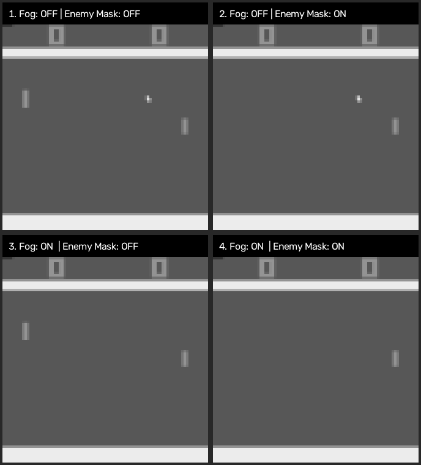

# Pong RL: Memory vs. Visual Shortcuts under Occlusion

Course project investigating whether a pixel-based PPO agent in Atari Pong (`ALE/Pong-v5`) tracks hidden ball state in its latent representations or relies on visual shortcuts (such as tracking the opponent's paddle) when the ball is occluded.



## Project Structure

```text
.
├── assets/                 # Visualizations of the 4 wrapper states
├── scripts/
│   ├── evaluate_sweep.py   # Frozen evaluation of a whole sweep on every view (resumable, CPU workers)
│   ├── fog_exposure.py     # How long the fog hides the ball and what still reveals it
│   └── render_states.py    # Generates the 2x2 grid of wrapper screenshots
├── src/pong_rl/
│   ├── __init__.py
│   ├── envs.py             # Environment factory (AtariPreprocessing + custom wrappers + FrameStack)
│   ├── models.py           # CNN, CNN + LSTM and attention + LSTM Actor-Critics, exposing hidden states and attention
│   ├── train.py            # CleanRL-based PPO training loop (feedforward or recurrent) with W&B tracking & checkpointing
│   ├── rollouts.py         # Fixed-length rollouts (256 steps per game), episode reporting and GAE
│   ├── ppo.py              # PPO update; recurrent agents replay whole sequences from saved memory
│   └── wrappers.py         # Custom `FogWrapper` (agent half) and `EnemyMaskWrapper` (enemy paddle)
├── pyproject.toml          # Project dependencies (managed with `uv`)
└── run_all.sh              # Two-stage sweep: from scratch, then fine-tuning from the clean runs
```

## Setup

Install dependencies with [`uv`](https://docs.astral.sh/uv/):

```bash
uv sync
```

Run the tests (pytest is in the `dev` dependency group, installed by `uv sync`):

```bash
uv run pytest
```

## Architectures

| `--arch` | Input per step | Memory | Reference |
|---|---|---|---|
| `cnn` (default) | 4 stacked 84x84 frames | none beyond the 4 frames | CleanRL `ppo_atari.py` |
| `lstm` | 1 84x84 frame | LSTM (128 units) over the whole episode | CleanRL `ppo_atari_lstm.py` |
| `attn_lstm` | 1 84x84 frame | LSTM (128 units) that reads the frame through spatial attention | Mott et al. 2019, simplified |

| `--arch` | Parameters | Image to LSTM |
|---|---|---|
| `cnn` | 1,687,719 | (no LSTM) whole frame flattened to 512 features |
| `lstm` | 2,007,591 | whole frame flattened to 512 features |
| `attn_lstm` | 225,959 | weighted read of the 7x7 conv map, 128 numbers |

### Attention + LSTM (`attn_lstm`)

Based on Mott et al. (2019), *Towards Interpretable Reinforcement Learning Using Attention Augmented
Agents*, simplified. Each step:

1. The three Nature CNN convolutions turn the frame into a 7x7 map of 64 features (49 cells; no flatten
   and no 512-unit dense layer). Two fixed channels add each cell's x and y position in [-1, 1].
2. Each cell gives a key (32 numbers) and a value (64 numbers) per head; there are 2 heads.
3. Each head's query comes from the previous LSTM output h(t-1), so memory decides where to look.
4. A softmax over the 49 scores `q · k / sqrt(32)` gives each head's attention weights. Queries and keys
   are layer-normalised per head first (query-key normalisation, no learned scale). Without it the scores
   start near zero, the weights stay uniform and, in a supervised check, never became selective.
5. The weighted sums of values, concatenated over heads (2 x 64 = 128), are the LSTM's only input.
   Actor and critic read the LSTM output, as in `lstm`.

`AttentionLSTMAgent.get_states_and_attention` returns the weights, shaped `(steps * batch, 2, 49)`,
with cells in row-major order (row = y, column = x), for analysing where the agent looks. Each cell of
the 7x7 map summarises an overlapping 36x36-pixel patch, with centres 8 pixels apart. The model is much
smaller than the other two because it drops the 3136-to-512 dense layer; keep this in mind when comparing.

All three use the same Nature CNN convolutions, PPO hyperparameters and collection rule.
Each batch, **16 games** each play **256 steps** (`--num-envs`, `--num-steps`), 4,096 steps in total, all with
the same frozen policy; then the PPO update runs. A game that ends inside a rollout is reset immediately
(memory too) and keeps playing. Memory otherwise continues across points and across updates.

The batch is cut into sequences at game ends only, so a sequence is at most 256 steps long and usually
spans several points. The CNN shuffles single steps into minibatches. Both recurrent agents (`lstm`,
`attn_lstm`) replay each sequence in order from its saved starting memory, with gradients over the whole
sequence. Recurrent minibatches group whole sequences, balanced by step count, and pad them with padding
masked out of the loss.

Replay retains activations for batches of up to 2048 padded steps. Larger batches use
activation checkpointing to recompute 32-step chunks and reduce accelerator memory use;
those compute chunks do not detach memory or truncate gradients within a sequence.

All architectures use four PPO epochs with four minibatches per epoch (16 optimizer steps per batch).
Losses are weighted by actual step counts, and advantages are normalized over the batch. GAE continues
across scoring points. A true game end has zero bootstrap value; a timeout uses the final observation and
pre-reset memory; the end of a rollout bootstraps from the current observation and memory.

The timestep target is a **soft aggregate environment-step budget**: the last batch is always completed,
so the actual count can exceed the target by less than one batch. Learning-rate annealing uses actual
collected steps. W&B and checkpoints record actual steps and update counts; W&B also records batch
steps, points, sequences, game endings and budget overshoot.

## Running Training

### Single Run

```bash
# 1. Baseline (Fog OFF, Enemy Mask OFF)
uv run pong-rl --seed 1

# 2. Enemy paddle masked
uv run pong-rl --mask-enemy --seed 1

# 3. Fog on agent's half of the court
uv run pong-rl --use-fog --seed 1

# 4. Both Fog and Enemy Mask enabled
uv run pong-rl --use-fog --mask-enemy --seed 1
```

Add `--arch lstm` (CNN + LSTM) or `--arch attn_lstm` (attention + LSTM) to any of the commands above.

Useful flags:
- `--total-timesteps 15000000` (default: `15_000_000`, matching the last checkpoint milestone)
- `--init-from PATH` (fine-tune from a checkpoint; see [Fine-tuning](#fine-tuning))
- `--num-envs 16`, `--num-steps 256` (games played side by side, and steps each game plays per batch)
- `--update-epochs 4`, `--num-minibatches 4` (PPO epochs, and minibatches per epoch)
- `--target-kl 0.015` (optional: skip a batch's remaining epochs once an epoch's mean approximate KL exceeds it)
- `--learning-rate`: initial learning rate, linearly annealed. Default: 0.001 for every architecture (the first sweep)
- `--ent-coef 0.02` (entropy bonus coefficient)
- `--no-track` (disable Weights & Biases logging for quick local testing)
- `--parallel-envs` (one CPU process per game; faster collection for a single job; uses more host memory)
- `--replay-checkpoint-threshold 2048` (retain activations for small replay batches; `0` always recomputes to save memory)
- `--report-window-steps 500000` (report episodes ending in the latest 500,000 aggregate environment steps)

### Training performance

Use `--parallel-envs` for a single GPU training job to collect games in separate CPU
processes. Leave it off when running many simultaneous jobs unless CPU and RAM allow
one worker per environment per job. A single job alternates between collecting (GPU mostly
idle) and updating; running several jobs at once is what keeps the GPU busy. Small recurrent replay batches retain activations;
`--replay-checkpoint-threshold 0` restores always-on activation recomputation when memory
is limited. Both paths preserve gradients within each collected sequence and the same PPO optimizer groups.
Training logs and W&B report collection and update times separately.

Run a short benchmark without W&B, checkpoints, or changing existing runs:

```bash
uv run python scripts/benchmark_training.py --parallel-envs --arch attn_lstm --gpu-util
uv run python scripts/benchmark_training.py --replay-checkpoint-threshold 0
```

The first two iterations are excluded from benchmark summaries. Compare identical
settings and avoid running other GPU workloads during measurements.

### Training reports

`charts/window/*` uses the interval `(max(start, global_step - report_window_steps), global_step]`,
where `start` is 0 from scratch and the parent's step when fine-tuning.
An episode belongs to a window according to its **end step**; its return and length cover the whole
episode, including any part before that window. The window reports its bounds, warm-up coverage,
episode count, mean return, mean episode length, completed games, wins, losses, draws, and timeouts.
Ongoing episodes are not included, so compare episode counts and lengths alongside the averages.
An empty window has undefined averages (`null`), rather than a misleading zero score.

Next to each run's `episodes_<time>.jsonl`, `updates_<time>.jsonl` has one row per PPO update: step,
batch shape, points and game endings, learning rate, collection and update seconds, and the PPO
diagnostics (`losses/approx_kl`, `losses/clipfrac`, `losses/explained_variance`, ...; non-finite values
are written as `null`).

`completed_win_rate = wins / completed_games`, including draws in the denominator and excluding
timeouts. When no games completed, that rate is undefined. `positive_return_fraction` counts every
positive-return episode, including timeouts, and is explicitly **not** a win rate. If both termination
and truncation flags are true, genuine game termination takes precedence.

Every episode is also written to `logs/<run folder>/episodes_<start time>.jsonl` (same folders as the
checkpoints below), with its exact end flags, outcome, return, length, training seed and condition. Raw W&B `charts/episodic_return` remains available;
it describes a changing training policy, not a frozen-model evaluation.

These logging changes apply to newly started processes. Existing training jobs keep their loaded
code. Historical return/length logs cannot reliably recover true wins versus timeouts; do not infer
those outcomes solely from an episode's length.

### Checkpoints during training

Snapshots are taken at **0, 1M, 2M, 3M, 4M, 5M, 7.5M, 10M, 11M, 12M, 13M, 14M and 15M aggregate
environment steps**; milestones beyond `--total-timesteps` are not requested. A from-scratch run saves its untrained
weights at 0. Each snapshot is saved after the first PPO update that reaches or passes
its milestone (batches are never cut short), so its actual step count can be above the
filename's milestone. If one batch crosses multiple milestones, those files hold the same weights.

Each run has its own folder, `checkpoints/<scratch|finetune>/<arch>/<condition>/seed_<n>/`, where the
condition is `clean`, `mask`, `fog` or `fog_mask`. A fine-tune's folder also names its parent
checkpoint, e.g. `clean_10.0M_to_fog`, so fine-tunes from different parents never share files:

```text
checkpoints/
├── scratch/lstm/fog_mask/seed_1/
│   ├── step_00.0M.pt  step_01.0M.pt  ...  step_10.0M.pt  ...  step_15.0M.pt
│   └── final.pt
└── finetune/lstm/clean_10.0M_to_fog_mask/seed_1/
    ├── step_10.0M.pt   # the parent's weights, before fine-tuning
    ├── step_11.0M.pt  ...  step_15.0M.pt
    └── final.pt
```

Each file records `checkpoint_step` (requested milestone), `global_step` (actual experience), `updates`,
`optimizer_steps`, `run`, `kind`, `start_step` and `steps_since_start` (experience gathered by this run
itself), and for fine-tunes `init_from` (parent path, hash, condition and step). In a fine-tune, `updates`
and `optimizer_steps` count from its own start while `global_step` continues from the parent. Its first
file (`step_10.0M.pt`, `steps_since_start = 0`) holds the parent's weights but records the fine-tune's
condition, so evaluating it is a zero-shot test of the clean model on that condition; filter on
`kind` and `steps_since_start` when grouping checkpoints by condition. `final.pt` is the end-of-training model; with a budget that ends on a milestone it
holds the same weights as the last snapshot, and it marks the run as complete. Snapshots are written
atomically and uploaded to W&B when tracking is enabled. `--no-save-model` disables all saves.
All these files work with `pong-eval`.

### Fine-tuning

```bash
uv run pong-rl --arch lstm --use-fog --mask-enemy --seed 1 \
  --init-from checkpoints/scratch/lstm/clean/seed_1/step_10.0M.pt
```

Fine-tuning loads all weights from a checkpoint of the same architecture and trains on the new
condition with a fresh Adam optimizer, using the same hyperparameters as training from scratch. The
step count continues from the parent (about 10M to 15M), so fine-tuned and from-scratch runs share one
step axis and the same total experience at 15M. W&B also logs `charts/steps_since_start`, the
experience gathered under the new condition, and SPS counts only this run's own steps. The learning rate restarts at its base value and
anneals to zero over the fine-tune's own steps. Note that a 10M snapshot from a 15M run was taken
while its learning rate was still decaying, unlike a model trained with a 10M budget.

### Evaluate saved models

Where every result of the project lives (checkpoints, evaluations, analyses, archive): `docs/data.md`.

```bash
# Evaluate every final model (scratch and fine-tuned) with the same 20 seeds and sampling policy:
uv run pong-eval checkpoints/*/*/*/seed_*/final.pt --episodes 20 --seed 10000 \
  --policy stochastic --device cpu --output my_evaluation.json

# Optional alternative protocol: always choose the most probable action.
uv run pong-eval checkpoints/scratch/cnn/fog_mask/seed_1/final.pt --policy greedy
```

`--view clean|mask|fog|fog_mask` plays every checkpoint on that view instead of its own (`--view own`, the
default). Reports record both: `use_fog`/`mask_enemy`/`eval_view` for the view played and
`train_use_fog`/`train_mask_enemy`/`train_view` for the view the model was trained on.

To evaluate a whole sweep on every view (the frozen evaluation in `docs/analysis_plan.md`):

```bash
# cnn + lstm: scratch finals, fine-tune finals and the clean 10M parents, each on all 4 views,
# 30 games (seeds 10000-10029), sampling policy, 4 CPU processes -> evaluations/sweep_stochastic.jsonl
uv run python scripts/evaluate_sweep.py
uv run python scripts/evaluate_sweep.py --policy greedy --roles scratch --views own   # greedy check
uv run python scripts/evaluate_sweep.py --archs attn_lstm attn_lstm_wide --dry-run   # list the jobs only
# Fine-tune vs scratch after the same k = 0..5M steps on the target view (mask, fog, fog_mask), own view:
# scratch step_00.0M..step_05.0M against fine-tune step_10.0M..step_15.0M (step_10.0M = the parent's weights)
uv run python scripts/evaluate_sweep.py --equal-steps
```

How long the fog hides the ball, and what still gives its position away: `scripts/fog_exposure.py` replays
the evaluation's games of the fog / fog_mask scratch finals on their own view while reading the clean screen
(`make_env(..., tap_clean_frame=True)`), and reports per checkpoint the hidden stretches of the ball (incoming
vs outgoing), the share of hidden steps on which a 4-frame stack holds no ball, and how closely each paddle's
height follows the hidden ball's (`evaluations/fog_exposure.jsonl`, with per-step traces).

```bash
uv run python scripts/fog_exposure.py      # 30 games per checkpoint, 4 CPU processes, a few minutes
```

It writes one JSON line per (checkpoint, view) as soon as it finishes; rerunning with the same output
skips the jobs already there (same checkpoint bytes, view and protocol), so an interrupted run resumes.
Before any game it checks every checkpoint against its folder (architecture, training view, scratch or
fine-tune, the fine-tune's recorded parent hash) and stops on a mismatch. A killed worker or SIGTERM stops the
run cleanly; rerun the same command to resume. Greedy caveat: with sticky actions off, a game's start depends
only on the reset no-op count, and seeds 10000-10029 give 19 distinct counts, so greedy games repeat
(effective n = 19); stochastic evaluation is unaffected.

Evaluation freezes the weights (`eval` and inference mode), restores each checkpoint's architecture
and visibility condition (unless `--view` overrides it), and uses four input frames for `cnn`
and one for the recurrent agents. Each episode
resets the environment to `seed + episode_index` and clears recurrent memory after either completion or timeout.
Stochastic evaluation resets a separate CPU action generator to that episode's seed, independently
of model initialization. Use the same episode count, seed, policy and device for comparisons;
shared seeds do not promise bitwise identical results across devices or software versions.

The existing Atari time limit is preserved and recorded in the report. The JSON contains separate
completed wins/losses/draws and timeouts, the completed-game win-rate denominator, every episode's
score/length/end flags, checkpoint hashes, and the evaluation protocol. Report output cannot alias
an input checkpoint. It is saved atomically after each checkpoint, with `complete: false` until all
requested models have been evaluated. CPU is the default so evaluation can run alongside training
without using its GPU, though it still consumes CPU resources.

The checkpoint evaluator also works with the current sweep's existing saved models; no training
restart or change to the optimizer, learning-rate schedule, or training time limit is required.

### Full Experiment Sweep

`run_all.sh` runs two stages (bash 4.3 or newer):

1. **scratch**: every architecture × condition (`clean`, `mask`, `fog`, `fog_mask`) × seed, to 15M steps.
2. **finetune**: each finished clean scratch run's `step_10.0M.pt`, fine-tuned on `mask`, `fog` and
   `fog_mask` to 15M (another parent milestone: `PARENT_CHECKPOINT=step_05.0M.pt`).

Defaults: `ARCHS="cnn lstm attn_lstm"`, `SEEDS="1 2 3"`, 8 parallel jobs, i.e. 36 scratch and 27 fine-tuning runs.
Fine-tuning starts after every scratch run has finished, and only from parents whose run completed.
Runs whose `final.pt` exists are skipped, so rerunning the script resumes an interrupted sweep; an
unfinished run's checkpoint and log folders are first moved aside to `<folder>.aborted_<time>`.
Runs finished with older code (rally-based batches) are skipped too, and fine-tunes would start from
their checkpoints (`pong-rl` prints a warning); move old `checkpoints/` and `logs/` aside before a fresh sweep.

```bash
bash run_all.sh                        # both stages
STAGES=scratch bash run_all.sh         # only stage 1 (or STAGES=finetune)
ARCHS=lstm SEEDS="1" bash run_all.sh   # a subset
MAX_PARALLEL=6 bash run_all.sh         # at most 6 simultaneous jobs
```

Each run's console output goes to `logs/<run folder>/train.log`, next to its episode log.
